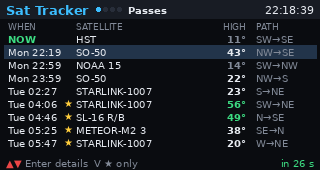
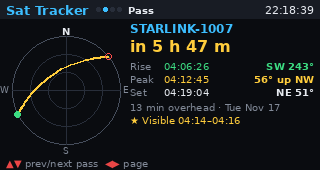
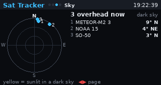
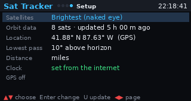

# Sat Tracker for CardputerZero

Find out when the **ISS** and other satellites fly over you, where to look, and whether you can see them with your own eyes, on the M5Stack CardputerZero.

 
 

## Pages

| # | Page | What it shows |
|---|---|---|
| 1 | Passes | Every pass in the next 24 hours: time, satellite, how high it gets (**HIGH**), and which way it moves (**PATH**, e.g. SW→NE). A yellow ★ marks passes you can **see with the naked eye**: the satellite is in sunlight while your sky is dark. |
| 2 | Pass | One pass in detail: its path on a sky chart (green dot = where it rises), a countdown, rise / peak / set times with compass directions, and while it's up, exactly where to look and how far away it is. |
| 3 | Sky | Every satellite in the group that's above the horizon right now, numbered on a sky chart and listed by height. |
| 4 | Setup | Satellite group, orbit data age and update, your location, lowest pass to show, miles or km, and a clock check. |

The sky charts are drawn like a map lying flat: **N at the top, E on the right**, the edge is the horizon and the centre is straight overhead.

## Keys

The red arrows printed on the keys work as arrows.

| Key | Action |
|---|---|
| ◀ ▶ (the Z / C keys), Tab, or 1–4 | Change page |
| ▲ ▼ (the F / X keys) | Move up / down; on the Pass page, previous / next pass |
| Enter | Open a pass, or change the selected setting |
| V | Show only naked-eye (★) passes |
| U | Update orbit data |
| L | Type your location |
| ESC | Quit |

## Satellite groups

- **Space stations:** the ISS and China's Tiangong station (and visiting spacecraft).
- **Brightest (naked eye):** the ~150 satellites and rocket bodies easiest to spot.
- **Amateur radio:** ham-radio satellites, handy for planning contacts.
- **Weather:** NOAA and Meteor polar-orbiting weather satellites.

Docked modules and visiting spacecraft (for example ISS + Nauka + Progress) fly together, so they're shown as one pass; the Pass page shows "+3" after the name.

Satellites far from Earth (more than about 225 minutes per orbit, such as geostationary weather satellites) aren't predicted; they don't make passes the way low satellites do.

## What you need

- **Wi-Fi**, now and then, to download orbit data from [CelesTrak](https://celestrak.org). It's saved on the device and updated automatically when it's a day old. CelesTrak asks apps not to download more often than every 2 hours, so the app won't. Orbit data stays good for about a week; after that, predictions drift by minutes.
- **Your location.** With the **Cap LoRa-1262** attached, the app uses its GPS: take it outside once and it remembers the spot. Without it, press **L** and type it, for example `40.71 N 74.01 W` or `40.71, -74.01`. Your location is only stored on the device (`~/.config/pocket-sattrack/config.json`). Nothing is sent anywhere.
- **The right time.** Predictions are only as good as the clock. The Setup page shows whether the clock was set from the internet or checked by GPS. If the GPS shows the clock is off, the app corrects for it.

## Tips for seeing the ISS

- The best passes are the ★ ones within a couple of hours after sunset or before sunrise.
- Look in the **Rise** direction a minute early. It appears as a bright, steady star moving across the sky in a few minutes, with no blinking.
- Passes higher than about 40° are the brightest.

## Install

```
scp pocket-sattrack_1.0.3-rev1_arm64.deb YOURUSER@DEVICE-IP:~/
ssh YOURUSER@DEVICE-IP
sudo apt install ~/pocket-sattrack_1.0.3-rev1_arm64.deb
sudo reboot
```

The reboot applies the GPS permissions: the serial port (`dialout` group), plus a boot-time entry (`/usr/lib/tmpfiles.d/pocket-sattrack.conf`) that lets the `gpio` group switch on the Cap's power. Without the Cap, everything except the GPS still works.

## Technical notes

- **Orbit model:** SGP4 (near-Earth), written from Vallado et al., *Revisiting Spacetrack Report #3*, with WGS-72 constants and vectorised with NumPy. It matches the Spacetrack Report #3 test case to within 10 m over 24 hours.
- **Coordinates:** TEME to Earth-fixed via GMST; observer on the WGS-84 ellipsoid; topocentric azimuth / elevation / range.
- **Visibility:** checked along the whole pass, so a satellite that leaves or enters Earth's shadow part-way through still gets a ★, and the Pass page shows when you can see it. A pass counts as visible while the satellite is sunlit (cylindrical Earth shadow), at least 10° up, and the Sun is more than 6° below your horizon. Checked against Heavens-Above for the ISS and Tiangong: peak times match to within a second, and visible windows to within seconds.
- **Passes:** sampled every 30 s over 24 hours; rise and set are interpolated, and the peak is refined to 1 s.
- Pure Python, with no packages beyond Pillow and NumPy.

License: MIT.
